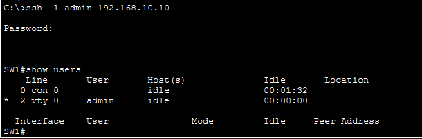

# Small Office LAN — Cisco Packet Tracer

## Project Overview

This project demonstrates the design, implementation, and verification of a small office Local Area Network (LAN) using Cisco Packet Tracer.

The network consists of four PCs connected to a Cisco Catalyst 2960 switch. The project focuses on fundamental networking concepts, including IPv4 addressing, Layer 2 switching, MAC address learning, ARP, ICMP connectivity testing, and secure remote switch management using SSH.

## Network Topology


### Network Devices

- 1 × Cisco Catalyst 2960 Switch (SW1)
- 4 × PCs (PC1, PC2, PC3, PC4)
- Copper Straight-Through Ethernet Cables

## IP Addressing Table

| Device | IP Address | Subnet Mask | Switch Port |
|---|---|---|---|
| PC1 | 192.168.10.1 | 255.255.255.0 | Fa0/1 |
| PC2 | 192.168.10.2 | 255.255.255.0 | Fa0/2 |
| PC3 | 192.168.10.3 | 255.255.255.0 | Fa0/3 |
| PC4 | 192.168.10.4 | 255.255.255.0 | Fa0/4 |
| SW1 | 192.168.10.10 | 255.255.255.0 | VLAN 1 (SVI) |

**Network ID:** 192.168.10.0/24  
**Broadcast Address:** 192.168.10.255  
**Usable Hosts:** 254  
**Default Gateway:** Not required for communication within this LAN.

## Project Objectives

- Design and implement a small office LAN.
- Configure static IPv4 addresses.
- Establish communication between connected devices.
- Understand Layer 2 switching and MAC address learning.
- Analyze ARP and ICMP using Simulation Mode.
- Configure a management IP address on the switch.
- Enable secure remote administration using SSH Version 2.
- Verify network connectivity and device configurations.

## Technologies and Concepts

- Ethernet LAN
- IPv4 Addressing and Subnetting
- Cisco IOS CLI
- Layer 2 Switching
- MAC Address Table
- ARP (Address Resolution Protocol)
- ICMP
- Switch Virtual Interface (SVI)
- SSH Version 2
- RSA 2048-bit Keys
- Local Authentication
- VTY Line Configuration

## Switch Configuration

The following commands summarize the main configuration steps performed on SW1.

### Basic Configuration

```cisco
enable
configure terminal
hostname SW1
ip domain-name company.local
```

### Management IP Configuration

```cisco
interface vlan 1
 ip address 192.168.10.10 255.255.255.0
 no shutdown
exit
```

### SSH Configuration

```cisco
username admin secret <LAB_PASSWORD>
crypto key generate rsa
! Select 2048 bits when prompted
ip ssh version 2

line vty 0 15
 login local
 transport input ssh
exit
```

The configuration uses a local administrator account and restricts remote VTY access to SSH.

### Save Configuration

```cisco
end
copy running-config startup-config
```

## Verification and Testing

### 1. ICMP Connectivity Test

Connectivity between the PCs was successfully verified using the `ping` command.

Example command executed from PC1:

```bash
ping 192.168.10.2
```

The successful ICMP replies confirmed connectivity between the devices.


### 2. MAC Address Learning

The switch dynamically learned the MAC addresses of connected devices from incoming Ethernet frames.

Verification command:

```cisco
show mac address-table
```

After generating network traffic, four connected devices were observed in the MAC address table.


### 3. SSH Remote Management

SSH Version 2 was configured to provide encrypted remote management access.

Connection command executed from PC1:

```bash
ssh -l admin 192.168.10.10
```

Successful authentication allowed remote access to the switch CLI.

Verification commands:

```cisco
show users
show privilege
show ip ssh
```

The `show users` output confirmed an active VTY session, while `show privilege` reported privilege level 15.



### 4. Interface Status Verification

Switch interface status was checked using:

```cisco
show interfaces status
```

All four connected FastEthernet ports were operational at 100 Mbps with full-duplex negotiation.

## Key Learning Outcomes

Through this project, I gained practical experience in:

1. Building and configuring a basic LAN topology.
2. Assigning static IPv4 addresses to end devices.
3. Understanding the difference between MAC addresses and IP addresses.
4. Observing ARP broadcasts and ICMP traffic in Simulation Mode.
5. Understanding how switches dynamically populate their MAC address tables.
6. Configuring a Switch Virtual Interface for management.
7. Generating RSA keys and enabling SSH Version 2.
8. Managing a Cisco switch remotely through VTY lines.
9. Verifying configurations using Cisco IOS troubleshooting commands.
10. Saving device configurations to NVRAM.

## Project Files

- **Packet Tracer Lab:** [Small-Office-LAN.pkt](Small-Office-LAN.pkt)
- **Network Topology:** [View Topology](Screenshots/Network%20Topology.png)
- **Connectivity Test:** [View Ping Test](Screenshots/Ping%20Test.png)
- **MAC Address Table:** [View MAC Table](Screenshots/MAC%20Address%20Table.png)
- **SSH Verification:** [View SSH Session](Screenshots/SSH-Connection.png)

## Tools Used

- Cisco Packet Tracer
- Cisco IOS CLI
- GitHub

---

**Project Category:** Networking Fundamentals  
**Environment:** Cisco Packet Tracer  
**Status:** Completed
